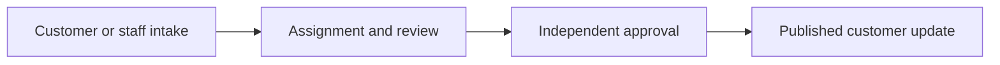

# Case management, under your control

Indice Cases brings customer requests and back-office work onto one case record. Customers submit through your applications; staff can open cases on their behalf. Both follow the same assignment, review and approval process, while internal work stays separate from customer-visible updates.

**It is a deployed product, not a SaaS service.** Your organisation runs the system, owns its databases and controls its workflows. Customer-facing websites and mobile apps connect through APIs; the product includes the staff back-office interface.

## Why Cases

Cases fits organisations that need repeatable, form-driven processes without building a separate back-office screen for every request type.

- **Customer requests and applications:** bring self-service and staff-assisted intake into one process.
- **Approval-heavy operations:** assign work, require an independent reviewer and capture rejection reasons.
- **Controlled customer communication:** publish progress without exposing internal checkpoints or staff comments.
- **Processes that change:** configure forms, states and workflows as requirements evolve.

A case keeps its data versions, checkpoints, comments and attachments together. Staff can follow its history, filter work lists, save queries and use workload metrics to understand what needs attention.

Technical details: configurable processes

A case type combines a JSON Schema, a JSON Forms layout, checkpoint definitions and an Elsa 2 workflow. Data is validated on the server. The back office renders forms from the layout and available actions from the running workflow, rather than requiring UI code for each process.

New processes built from existing forms and activities can be configured and published without redeploying the host. New integrations or custom activities still require development.

## How it works

Consider a customer application that needs preparation by one person and approval by another:

1. A customer submits through your app, or a staff member opens the request on their behalf.
2. The case is assigned and a staff member reviews or completes its information.
3. A different authorised person approves or rejects it, with a reason where required.
4. The workflow publishes the appropriate customer update and can trigger a notification through configured providers.

The customer and staff work from the same case, but do not see the same information. A customer can see "In progress" while staff work through an internal second approval.

Technical details: workflow and actions

A draft starts no workflow until submission. Submission starts the published Elsa definition tagged with the case type code. Blocking activities wait for assignment, editing, approval or a custom action; the staff API returns the actions available to the current user.

For maker-checker approval, the editor can be recorded as the first approver and blocked from approving again. Role restrictions and independent approval must be configured in the workflow; they are not assumed for every process.

[Workflow activities and examples](cases-reference.html#article-2-flows)

## Governance and visibility

Cases provides mechanisms for controlling who can act, what customers can see and how changes are recorded. Your team configures these controls around its own policies.

| Requirement | Product mechanism |
|---|---|
| Separate internal work from customer updates | Private checkpoints and published data versions |
| Limit staff access | System roles and record-level access rules |
| Keep customer records separate | Customer API ownership checks |
| Require independent decisions | Role-limited approvals and a previous-approver restriction |
| Review the history of a request | Checkpoints, data versions, comments, attachments and approval records |

These capabilities support governance; they do not, on their own, establish regulatory compliance. Access policies, workflow design and operational practices remain your organisation's responsibility.

Technical details: access and publication

Staff access combines role permissions with access rules for users, groups or roles on cases, case types and checkpoints. Administrators bypass record-level access rules by default; this behaviour is configurable.

Customer endpoints serve only the caller's own cases. Customers see the last public checkpoint and published data, not private transitions or staff comments. Every edit creates a data version; publication controls which version the customer receives.

[Access control and data model](cases-reference.html#article-1-core-features-capabilities)

## Deployment and ownership

Cases runs in your infrastructure as an ASP.NET Core application containing the API, Angular back office, workflow server and visual designer. Customer-facing applications remain separate and connect to the API.

| Included in the product | Owned by your organisation |
|---|---|
| Case engine, back-office UI and workflow activities | Hosting, identity provisioning and operational support |
| Schema-driven forms and visual workflow designer | Process definitions, permissions and publication policies |
| Integration contracts and extension interfaces | Connections to customer systems, notification providers and a PDF engine |
| Case and workflow persistence | Database operations, backups, upgrades and retention configuration |

Case records and workflow execution state use separate databases. This separates their storage and migrations, but both need to be planned for deployment and recovery.

Technical details: architecture and hosting

The stack uses ASP.NET Core Minimal APIs, EF Core with SQL Server, Elsa Workflows 2 and JSON Schema / JSON Forms. The host includes the back-office SPA and workflow designer. CasesDb stores case records; WorkflowDb stores workflow definitions, instances and bookmarks.

The case and workflow engines communicate over authenticated HTTP, including when hosted together. Redis is optional; the default access-decision cache uses memory. Workflow timers and retention run through hosted services and Quartz.

[Architecture and host composition](cases-reference.html#article-4-architecture-hosting)

## Implementation responsibilities

An implementation combines configuration with integration work. The product supplies the case-management foundation; your team defines the processes and connects the surrounding systems.

1. **Define the process:** forms, checkpoints, assignments, approvals and which updates become public.
2. **Provision the environment:** application host, databases, identity clients, roles and operational policies.
3. **Connect your systems:** customer lookup, data prefill and form lookups as needed. Register notification providers and a PDF engine if those outputs are required.
4. **Validate the end-to-end journey:** customer intake, staff-assisted intake, permissions, rejection paths, publication and recovery procedures.

Existing activities and schema-driven forms reduce the need for bespoke process screens. Custom business integrations, specialised workflow activities and customer-facing experiences still need engineering work. The supplied product guide does not establish a delivery timeline or implementation cost.

Technical details: extension points

Extensions are C# interfaces running in your host: `IContactProvider` for customer search, `ICaseDataInitializer` for prefill, named `ILookupService` implementations for dropdowns and `ICaseAuthorizationService` for additional access behaviour. Custom Elsa activities extend workflow logic.

PDF generation needs a host-provided `ICasePdfService`; the default conversion implementation is a no-op. The SMS notification service also needs a registered provider. Email activities use SMTP configuration.

[Configuration and extensibility reference](cases-reference.html#article-6-configuration)

## Technical reference

[Open the complete product and developer reference](cases-reference.html)

The reference includes the API surfaces, workflow activities, architecture diagrams, configuration tables and C# examples from the supplied product guide. Items labelled **next release** are planned capabilities, not claims about the current release.